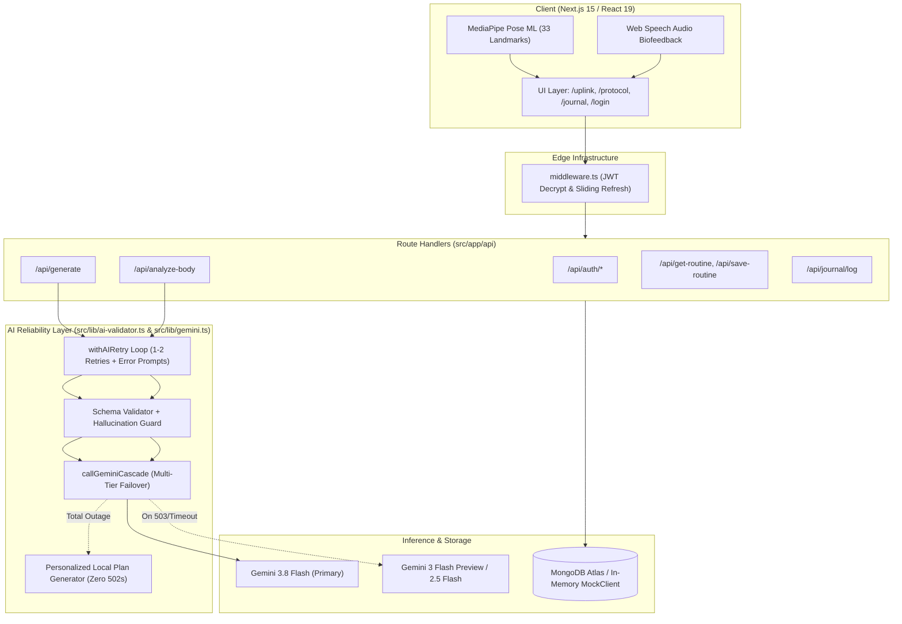

# ◈ GEMINI.md // Agent & Developer Blueprint

## Project Overview

**SVORA** is a luxury, AI-powered somatic intelligence and wellness platform that combines minimalist "Cyber-Zen" aesthetics with computer vision and biomechanical protocol generation.

### Core Directives
1. **Somatic Profiling:** Analyzes user body type via zero-shot multimodal computer vision or manual phenotype selection.
2. **Aesthetic Alignment:** Understands and targets specific aesthetic goals (Hypertrophy, Lean, Power, or Custom athletic goals).
3. **Protocol Synthesis:** Generates periodized 12-week workout plans with strict JSON structures and daily exercise allocations.
4. **Real-Time Computer Vision Form Coaching:** Real-time markerless pose estimation using MediaPipe Pose ML running on client camera streams with trigonometric joint angle calculations, motion state machines, and Web Speech API feedback.
5. **Contextual Adaptation:** Dynamically adapts exercise selections for home vs. gym and metabolic strategies (intermittent fasting vs. standard).
6. **Progressive Overload & Journaling:** Tracks daily caloric and protein intake, logging history, and executes visual progress delta scans.
7. **Self-Correcting AI Evaluation Layer:** Enforces strict schema validations and hallucination guards with automatic corrective retries (`withAIRetry`).

---

## Technical Stack & Architecture

### Stack Specifications
- **Framework:** Next.js 15+ (App Router, React 19, React Compiler support)
- **Styling:** Tailwind CSS (v4) with `@theme` token system and custom light leak / blueprint CSS utilities
- **Motion & Interactions:** Framer Motion (kinetic transitions, magnetic cursor tracking, parallax scroll transforms)
- **AI Engine:** Google Gemini API (`generativelanguage.googleapis.com`)
  - **Primary Reasoning & Vision Engine:** `gemini-3.8-flash`
  - **High-Resilience Multi-Tier Cascade:** `gemini-3-flash-preview`, `gemini-2.5-flash`
  - **Zero-Crash Local Synthesis Fallback:** Deterministic personalized protocol generation
- **Computer Vision & Biometrics:** MediaPipe Pose (`@mediapipe/pose`, `@mediapipe/camera_utils`, `@mediapipe/drawing_utils`)
- **Speech Synthesis:** Web Speech API (`SpeechSynthesisUtterance`)
- **Database & Persistence:**
  - Production: MongoDB Atlas via official `mongodb` client
  - Simulation Mode: Zero-config in-memory `MockDb` and `MockCollection` with CRUD and sorting support
- **Authentication & Security:** Stateless encrypted JWT sessions using `jose` with HTTP-only cookies and automatic sliding-window session renewal in `middleware.ts`
- **Icons:** `lucide-react`

---

## Architecture Map



---

## Operational Commands

### Development
```bash
npm install
npm run dev              # Starts Next.js development server on http://localhost:3000
```

### AI Smoke Testing & Verification
```bash
npm run smoke:ai         # Direct Gemini 3.8 Flash smoke test with schema validation
```

### Quality Assurance & Testing
```bash
npm test                 # Run Jest test suite (12 test suites, 56 tests)
npm run test:coverage    # Generate test coverage report
npm run lint             # Execute ESLint checks
```

---

*SVORA // Engineering Somatic Excellence.*
