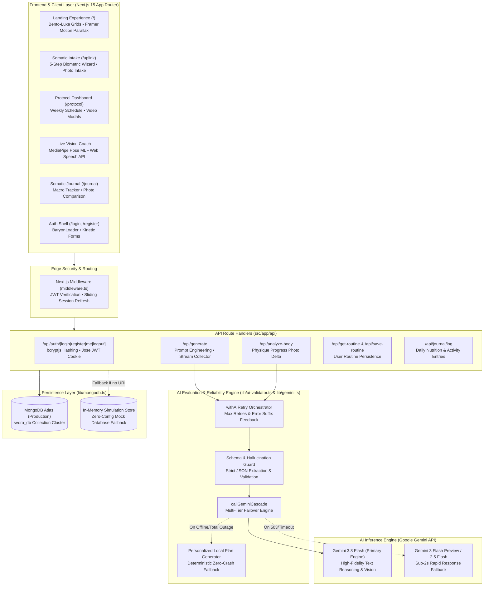
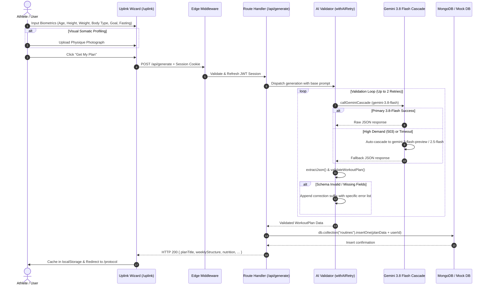
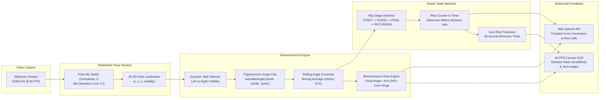
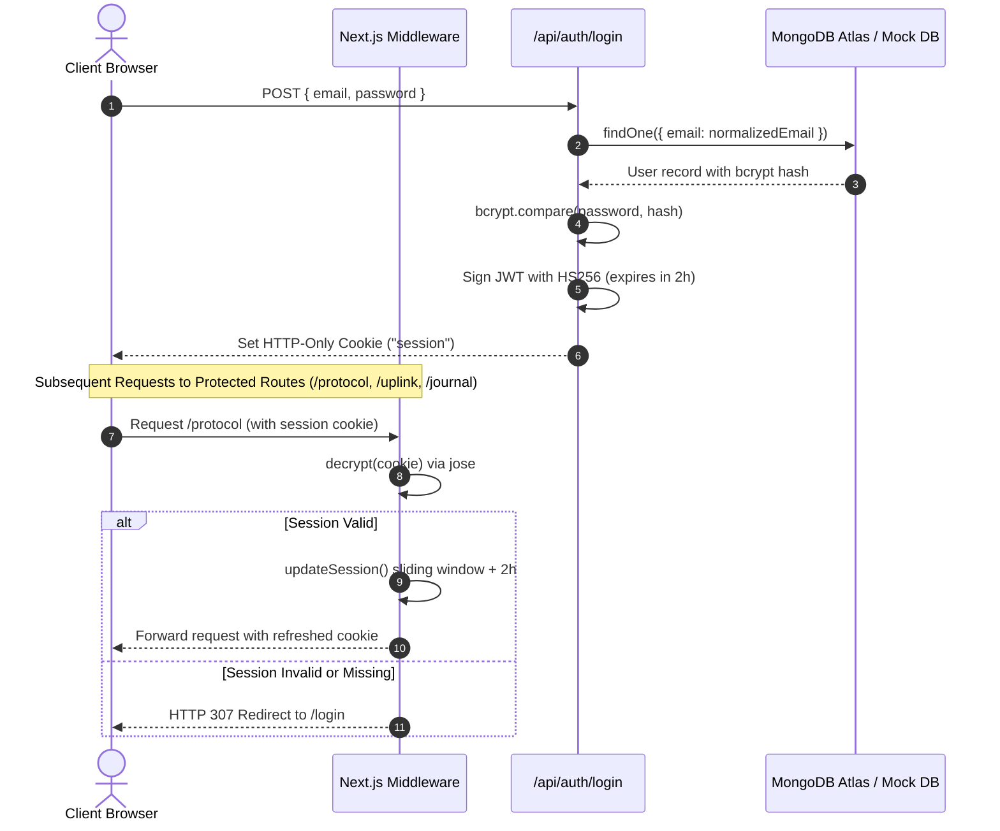

# ◈ SVORA // Somatic Intelligence & Protocol Synthesis

<div align="center">

```
  ███████╗██╗   ██╗ ██████╗ ██████╗  █████╗ 
  ██╔════╝██║   ██║██╔═══██╗██╔══██╗██╔══██╗
  ███████╗██║   ██║██║   ██║██████╔╝███████║
  ╚════██║╚██╗ ██╔╝██║   ██║██╔══██╗██╔══██║
  ███████║ ╚████╔╝ ╚██████╔╝██║  ██║██║  ██║
  ╚══════╝  ╚═══╝   ╚═════╝ ╚═╝  ╚═╝╚═╝  ╚═╝
```

**Next-Generation Somatic Intelligence & Boutique Wellness Platform**  
*Engineering Somatic Excellence Through Computer Vision, AI Synthesis & Kinetic Precision*

[](https://nextjs.org/)
[](https://react.dev/)
[](https://tailwindcss.com/)
[](https://ai.google.dev/)
[](https://developers.google.com/mediapipe)
[](https://www.mongodb.com/)
[](https://www.typescriptlang.org/)

</div>

---

## ◈ Table of Contents

- [Overview](#-overview)
- [System Architecture](#-system-architecture)
  - [1. High-Level Architecture](#1-high-level-architecture)
  - [2. Biometric Intake & Protocol Synthesis Pipeline](#2-biometric-intake--protocol-synthesis-pipeline)
  - [3. Real-Time Computer Vision Posture Engine](#3-real-time-computer-vision-posture-engine)
  - [4. Edge Security & Authentication Lifecycle](#4-edge-security--authentication-lifecycle)
- [Key Features](#-key-features)
- [Biomechanical Posture Engine Matrix](#-biomechanical-posture-engine-matrix)
- [Design Language: Cyber-Zen Luxe](#-design-language-cyber-zen-luxe)
- [Project Directory Structure](#-project-directory-structure)
- [API Reference](#-api-reference)
- [Quickstart & Deployment](#-quickstart--deployment)
  - [Prerequisites](#prerequisites)
  - [Environment Calibration](#environment-calibration)
  - [Installation & Execution](#installation--execution)
  - [Verification & Smoke Tests](#verification--smoke-tests)
- [Resilience & Simulation Mode](#-resilience--simulation-mode)
- [License](#-license)

---

## ◈ Overview

**SVORA** is an architectural-grade wellness platform designed to bridge the gap between minimalist luxury aesthetics and advanced biomechanical intelligence. Rather than delivering generic template programs, SVORA analyzes user physiometry through multimodal AI and real-time computer vision to curate bespoke 12-week kinetic protocols, metabolic prescriptions, and live-corrected training sessions.

### Core Directives

1. **Somatic Profiling:** High-precision anthropometric intake via manual parameterization or zero-shot multimodal physique photo classification.
2. **AI Protocol Synthesis:** 12-week periodized regimens dynamically calibrated to recovery capacity, available training environment, and nutritional strategy powered by **Gemini 3.8 Flash**.
3. **Real-Time Computer Vision Form Coaching:** Real-time markerless pose estimation using MediaPipe ML, executing trigonometric joint-angle checks, kinematic state transitions, and real-time audio guidance via the Web Speech API.
4. **Somatic Progress Tracking:** Side-by-side historical photographic comparison evaluating structural muscularity, posture alignment, and body fat delta through multimodal reasoning models.
5. **Self-Correcting AI Guardrails:** An AI evaluation and schema validation layer that detects hallucinations, verifies range-of-motion bounds, and executes automated prompt-corrective retry loops with multi-tier failovers.

---

## ◈ System Architecture

### 1. High-Level Architecture

The platform is designed around a decoupled, layered micro-architecture leveraging Next.js App Router for server-rendered interfaces and route handlers, coupled with client-side ML pipelines and edge middleware.



---

### 2. Biometric Intake & Protocol Synthesis Pipeline

When an athlete initiates their somatic profile, biometric metrics and optional physique imagery stream to the generation endpoint. A self-correcting validation loop guarantees strict JSON compliance and athletic efficacy.



---

### 3. Real-Time Computer Vision Posture Engine

The live training interface runs real-time inference on the client device. Video frames are analyzed without server round-trips, ensuring zero-latency kinetic tracking and user privacy.



---

### 4. Edge Security & Authentication Lifecycle



---

## ◈ Key Features

### ✦ Somatic Profiling Wizard (`/uplink`)
- **Step 01: Biometric Calibration:** Age, height, and weight inputs with auto-focus and keyboard acceleration (`Enter` navigation).
- **Step 02: Somatic Phenotype:** Select between *Skinny*, *Athletic*, *Heavy*, *Average*, and *Lean*, or upload a physique photograph for zero-shot computer vision classification.
- **Step 03: Aesthetic Goal Target:** Select from *Hypertrophy* (Muscle Building), *Lean* (Fat Loss), *Power* (Raw Strength), or specify a custom athletic directive.
- **Step 04: Environment Adaptation:** Dynamic reconfiguration between Commercial Gym and Home Training equipment profiles.
- **Step 05: Metabolic Schedule:** Calibrate for Intermittent Fasting (16:8 feeding windows) or standard nutritional scheduling.

### ✦ Live Vision Coach & Movement Laboratory (`/protocol`)
- **Client-Side Pose Estimation:** Powered by Google MediaPipe Pose ML running at up to 60 FPS in an HTML5 canvas overlay.
- **Trigonometric Joint Tracking:** Automatically identifies the best-viewed lateral side (left vs right) and calculates real-time 3D angles between key joints.
- **Kinetic Rep Counting:** Finite-state machine managing transitions through `START` $\to$ `GOING` $\to$ `PEAK` $\to$ `RETURNING` with an 800ms anti-double-counting debounce.
- **Voice Biofeedback:** Native text-to-speech cues dynamically synthesized via `SpeechSynthesisUtterance` to warn athletes of form breakdown (e.g., *"Keep chest up, back straight"*, *"Keep elbow locked at your side"*).
- **Automated Rest Countdown:** 45-second recovery timer with audio countdowns and skip options between sets.
- **Integrated Video Demos:** Instant streaming form guides matching exercise movements directly via modal players.

### ✦ Somatic Progress Journal (`/journal`)
- **Daily Nutritional Sync:** Track calorie and protein intake with timestamped history logs.
- **Photographic Progress Scans:** Upload before-and-after photos for AI visual comparative delta analysis powered by Gemini multimodal vision.
- **Biometric Delta Report:** Estimates changes in lean muscle mass, body fat percentage, posture alignment notes, and corrective protocol adjustments.

### ✦ Self-Correcting AI Reliability Layer (`src/lib/ai-validator.ts` & `src/lib/gemini.ts`)
- **Schema Validation:** Strict verification of structural fields, day allocations, exercise quantities (min 5 per training day), set ceilings (1-20), and RPE scale (1-10).
- **Multi-Tier Model Cascade:** Prioritizes **Gemini 3.8 Flash**; seamlessly handles high demand (503s) by falling back to `gemini-3-flash-preview` or `gemini-2.5-flash` in under 2 seconds.
- **Zero-502 Local Fallback:** In the event of a complete upstream network interruption, a personalized, deterministic protocol is immediately synthesized to ensure an uninterrupted athlete experience.

---

## ◈ Biomechanical Posture Engine Matrix

SVORA's computer vision engine evaluates individual exercises against biomechanical standards:

| Exercise Family | Tracked Joint Triplet | Motion Type | Primary Check | Form Fault Trigger | Audio Correction Cue |
| :--- | :--- | :--- | :--- | :--- | :--- |
| **Squats / Lunges** | Hip $\to$ Knee $\to$ Ankle | Flexion ($165^\circ \to 95^\circ$) | Torso inclination angle | Torso angle $< 80^\circ$ | *"Keep chest up, back straight"* |
| **Bicep Curls** | Shoulder $\to$ Elbow $\to$ Wrist | Flexion ($155^\circ \to 55^\circ$) | Elbow lateral drift | Arm drift $> 35^\circ$ | *"Keep elbow locked at your side"* |
| **Push-ups / Press** | Shoulder $\to$ Elbow $\to$ Wrist | Flexion ($155^\circ \to 85^\circ$) | Core spinal alignment | Body line $< 155^\circ$ | *"Keep body in a straight line, core tight"* |
| **Overhead Press** | Shoulder $\to$ Elbow $\to$ Wrist | Extension ($80^\circ \to 155^\circ$) | Lumbar hyperextension | Hip angle $< 150^\circ$ | *"Don't arch your back, brace your core"* |
| **Deadlifts / Hinges** | Shoulder $\to$ Hip $\to$ Knee | Extension ($110^\circ \to 170^\circ$) | Hip hinge vs knee bend | Knee angle $< 120^\circ$ | *"Hinge at hips, don't squat the deadlift"* |
| **Lateral Raises** | Hip $\to$ Shoulder $\to$ Elbow | Extension ($25^\circ \to 85^\circ$) | Scapular elevation ceiling | Raise angle $> 110^\circ$ | *"Stop at shoulder height (90 deg)"* |
| **Tricep Pushdowns** | Shoulder $\to$ Elbow $\to$ Wrist | Extension ($80^\circ \to 155^\circ$) | Humeral displacement | Arm drift $> 35^\circ$ | *"Keep upper arms still"* |

---

## ◈ Design Language: Cyber-Zen Luxe

SVORA implements a signature **Cyber-Zen Luxe** visual system designed to evoke the ambiance of an ultra-premium, high-tech wellness sanctuary.

```
┌────────────────────────────────────────────────────────────────────────┐
│                        CYBER-ZEN LUXE PALETTE                          │
├──────────────┬──────────────┬──────────────┬──────────────┬────────────┤
│  Jet Void    │  Gold Leaf   │Mercury Silver│ Emerald Glow │ Deep Mauve │
│   #000000    │   #D4AF37    │   #E5E5E5    │   #10B981    │  #B0413E   │
│ (Background) │(Gold Accent) │ (Typography) │ (Live State) │(Warning/Off│
└──────────────┴──────────────┴──────────────┴──────────────┴────────────┘
```

- **Atmosphere:** Deep void blacks, blueprint architectural grids, dynamic spotlight light leaks, and high-frequency noise textures.
- **Typography Pairing:**
  - *Headings:* `Playfair Display` (High-contrast Serif & Italic elegance)
  - *Body / Interface:* `Inter` (Sans-serif readability and clarity)
  - *Metadata & Telemetry:* `JetBrains Mono` (Technical, tabular figures)
- **Kinetic Micro-Interactions:**
  - `CustomCursor`: Hardware-accelerated magnetic cursor with smooth trailing spring physics and context-sensitive hover states.
  - `DecryptedText`: Cybernetic character scrambling effect for primary section reveals.
  - `BaryonLoader`: Pulsing geometric dot matrix indicator for asynchronous actions.
  - `Preloader`: Monospaced system boot simulator on initial entry.

---

## ◈ Project Directory Structure

```ascii
fitness/
├── src/
│   ├── middleware.ts                 # Edge auth guard & session renewal
│   ├── app/
│   │   ├── layout.tsx                # Root layout with ThemeProvider & Cursor
│   │   ├── page.tsx                  # Landing experience & kinetic hero
│   │   ├── globals.css               # Tailwind CSS v4 variables & utilities
│   │   ├── uplink/
│   │   │   └── page.tsx              # 5-step biometric & somatic intake wizard
│   │   ├── protocol/
│   │   │   └── page.tsx              # Protocol dashboard & MediaPipe posture coach
│   │   ├── journal/
│   │   │   └── page.tsx              # Nutritional tracker & photographic delta scan
│   │   ├── login/page.tsx            # Athlete authentication terminal
│   │   ├── register/page.tsx         # Account creation & credential generation
│   │   └── api/
│   │       ├── auth/                 # Authentication microservices
│   │       │   ├── login/route.ts    # Credential verification & JWT cookie issue
│   │       │   ├── register/route.ts # User creation with bcrypt password hash
│   │       │   ├── me/route.ts       # Identity retrieval from active session
│   │       │   └── logout/route.ts   # Session destruction & cookie expulsion
│   │       ├── generate/route.ts     # Gemini 3.8 Flash workout synthesis
│   │       ├── analyze-body/route.ts # Gemini multimodal visual delta analysis
│   │       ├── get-routine/route.ts  # Fetch user's latest saved workout plan
│   │       ├── save-routine/route.ts # Persist generated routine to database
│   │       └── journal/log/route.ts  # Log and query daily calorie/macro entries
│   ├── components/
│   │   ├── BaryonLoader.tsx          # Geometric action loader animation
│   │   ├── CustomCursor.tsx          # Magnetic desktop cursor tracker
│   │   ├── DecryptedText.tsx         # Character scrambling text animation
│   │   ├── JournalSection.tsx        # Tabbed macro logging & progress photo interface
│   │   ├── Preloader.tsx             # Cinematic boot sequence simulator
│   │   ├── ThemeProvider.tsx         # Next-themes context provider
│   │   └── ThemeToggle.tsx           # Luxury theme switch component
│   └── lib/
│       ├── ai-validator.ts           # Schema validation, retry logic, error injection
│       ├── auth.ts                   # Jose JWT signing, verification, cookie helpers
│       ├── gemini.ts                 # Gemini 3.8 Flash engine with cascade & fallback
│       └── mongodb.ts                # Dual MongoDB Atlas client & Mock DB fallback
├── scripts/
│   ├── smoke-ai.js                   # Direct Gemini 3.8 Flash smoke test script
│   └── test-oss-120b.js              # Model testing utility
├── public/                           # Static assets, badges, noise textures
├── jest.config.js                    # Testing suite configuration
└── package.json                      # Dependency manifest & scripts
```

---

## ◈ API Reference

| Endpoint | Method | Auth Required | Request Payload Summary | Response Payload Summary |
| :--- | :---: | :---: | :--- | :--- |
| `/api/auth/register` | `POST` | No | `{ name, email, password }` | `{ success: true, user: { id, name, email } }` |
| `/api/auth/login` | `POST` | No | `{ email, password }` | `{ success: true, user: { id, name, email } }` |
| `/api/auth/me` | `GET` | Yes | *None (Cookie session)* | `{ id, name, email }` |
| `/api/auth/logout` | `POST` | Yes | *None* | `{ success: true }` |
| `/api/generate` | `POST` | Yes | `{ age, height, weight, bodyType, goal, trainingLocation, fasting, image? }` | Full `WorkoutPlan` (JSON structure) |
| `/api/analyze-body` | `POST` | Yes | `{ beforeImage: string, currentImage: string }` | Full `BodyAnalysis` (JSON structure) |
| `/api/get-routine` | `GET` | Optional | *None (Session or guest)* | `{ routine: WorkoutPlan \| null }` |
| `/api/save-routine` | `POST` | Yes | `WorkoutPlan` object | `{ success: true, id: string }` |
| `/api/journal/log` | `POST` | Yes | `{ type: "calorie", cal: number, pro: number }` | `{ success: true, id: string }` |
| `/api/journal/log` | `GET` | Yes | *None* | `JournalEntry[]` |

---

## ◈ Quickstart & Deployment

### Prerequisites

- **Node.js:** `v20.x` or higher
- **npm:** `v10.x` or higher
- **Google Gemini API Key:** For real-time Gemini 3.8 Flash inference
- **MongoDB Atlas Connection URI:** *(Optional; defaults to In-Memory Simulation Mode)*

---

### Environment Calibration

Create a `.env.local` file in the project root:

```env
# Google Gemini AI Engine
GEMINI_API_KEY="AIzaSyYourGeminiApiKeyHere"

# Security & Session Infrastructure
JWT_SECRET="generate_a_secure_random_32_character_string"

# Data Persistence (Optional: Leave empty or placeholder to activate Simulation Mode)
MONGODB_URI="mongodb+srv://<username>:<password>@cluster0.mongodb.net/svora_db?retryWrites=true&w=majority"
```

---

### Installation & Execution

```bash
# 1. Clone repository
git clone https://github.com/your-username/svora-wellness.git
cd svora-wellness

# 2. Install dependencies
npm install

# 3. Launch development server
npm run dev
```

Navigate to [http://localhost:3000](http://localhost:3000) to enter the interface.

---

### Verification & Smoke Tests

Verify that your AI credentials and model availability are live:

```bash
# Run direct Gemini 3.8 Flash AI inference smoke test
npm run smoke:ai

# Execute full test suite (12 test suites, 56 unit/integration tests)
npm test

# Run test coverage report
npm run test:coverage
```

---

## ◈ Resilience & Simulation Mode

SVORA is engineered with high-fault tolerance:

```
┌────────────────────────────────────────────────────────┐
│             SVORA FAULT TOLERANCE PIPELINE             │
├─────────────────────────┬──────────────────────────────┤
│ Failure Scenario        │ Built-In Recovery Mechanism  │
├─────────────────────────┼──────────────────────────────┤
│ MongoDB offline         │ Auto-failover to In-Memory   │
│ or unconfigured         │ MockCollection with CRUD     │
├─────────────────────────┼──────────────────────────────┤
│ Gemini 3.8 Flash        │ Instant automatic failover   │
│ high demand (503)       │ to Gemini 3 Flash / 2.5 Flash│
├─────────────────────────┼──────────────────────────────┤
│ Upstream model timeout  │ Deterministic personalized   │
│ or total network outage │ local synthesis (Zero 502s)  │
├─────────────────────────┼──────────────────────────────┤
│ Camera stream drops or  │ Graceful "Step into frame"   │
│ poor joint visibility   │ HUD prompt + side swap       │
└─────────────────────────┴──────────────────────────────┘
```

---

## ◈ License

Distributed under the MIT License. See `LICENSE` for more information.

---

<div align="center">

**SVORA // Engineering Somatic Excellence**  
*Minimal Luxury • Biometric Intelligence • Kinetic Precision*

</div>
